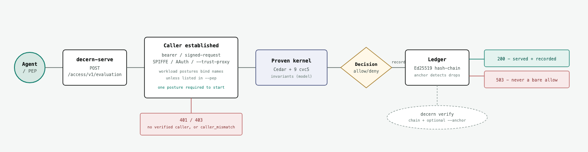
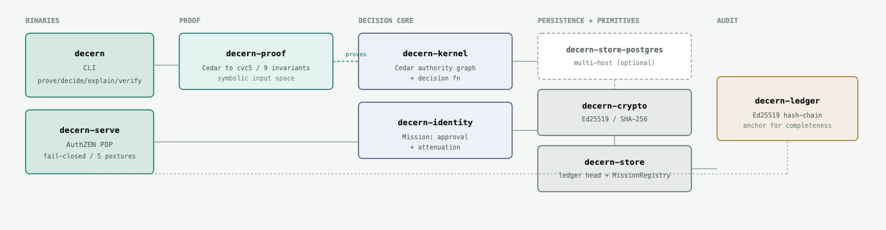

<!-- SPDX-License-Identifier: Apache-2.0 -->
<p align="center">
  <picture>
    <source media="(prefers-color-scheme: dark)" srcset="docs/img/decern-mark-dark.svg">
    
  </picture>
</p>

# decern

An authorization decision point that records. Every decision for an agent, a human or a
workload — one principal type, one pure function of `(principal, authority graph, policy,
now)` — is written to an Ed25519-signed, hash-chained ledger **before it is served**, and
that ledger verifies offline without trusting the operator. The model's safety invariants
are **machine-checked over its whole symbolic input space**, not tested on examples, by
Cedar's Lean-verified symbolic compiler ([cedar-policy-symcc](https://crates.io/crates/cedar-policy-symcc))
and the cvc5 solver. What that covers, and what it deliberately does not, is
[stated precisely](docs/CLI.md#what-proven-covers).

<p align="center">
  <a href="https://github.com/anivar/decern/actions/workflows/ci.yml"></a>
  <a href="https://scorecard.dev/viewer/?uri=github.com/anivar/decern"></a>
  <a href="https://crates.io/crates/decern-cli"></a>
  <a href="https://docs.rs/decern-ledger"></a>
  <a href="https://pypi.org/project/decern/"></a>
  <a href="https://www.npmjs.com/package/decern"></a>
  <a href="LICENSE"></a>
  <a href="https://doi.org/10.5281/zenodo.21848620"></a>
  <a href="https://github.com/anivar/decern/graphs/traffic"></a>
  <a href="https://github.com/anivar/decern/graphs/traffic"></a>
</p>

[Website](https://decern.anivar.net/) · [Commands](docs/CLI.md) · [Roadmap](ROADMAP.md) ·
[Releases](https://github.com/anivar/decern/releases) · [Security](SECURITY.md)

The industry standardizes how authority is *represented* — tokens, delegation envelopes,
decision-request formats — and defers the *guarantee* (that attenuation holds, that nothing
was dropped from the log, that a decision stayed within its mandate) to implementer policy.
decern is the guarantee.

## Quickstart

```sh
cargo install decern-cli decern-server
```

Two binaries: `decern` to prove and verify, `decern-serve` to answer requests. Prebuilt,
signed binaries for Linux (x64/arm64), macOS (Apple Silicon) and Windows (x64) are on the
[releases page](https://github.com/anivar/decern/releases); how to check a signature is in
[SECURITY.md](SECURITY.md#verifying-a-release). Only `decern prove` needs the **cvc5**
solver on `PATH`; serving answers does not.

```sh
# 1. Prove every invariant over the model's input space (cvc5)
decern prove

# 2. Run the PDP (writes a tamper-evident ledger); this walkthrough is its own caller
decern-serve --ledger /tmp/decern.jsonl --trust-proxy &

# 3. Decide over HTTP (AuthZEN-shaped) — corp reads a claim it owns
curl -s localhost:8080/access/v1/evaluation -H 'content-type: application/json' -d '{
  "subject":  {"type":"Principal","id":"corp"},
  "action":   {"name":"Read"},
  "resource": {"type":"Resource","id":"claim1"}
}'

# 4. Verify the ledger (hash chain + every signature)
decern verify --ledger /tmp/decern.jsonl \
  --pubkey "$(curl -s localhost:8080/pubkey | jq -r .kid)"
```

[`examples/quickstart.sh`](examples/quickstart.sh) runs the whole loop — prove → serve →
decide → verify → tamper-is-rejected — end to end. Thin AuthZEN 1.0 clients are published
for applications:

```sh
uv add decern                              # Python
npm install decern                         # TypeScript / JavaScript
go get github.com/anivar/decern/sdks/go    # Go
```

## What is proven

A decision is a pure function of `(principal, authority graph, policy, now)` — humans,
agents, and workloads are one principal type, decided by the same function. **9 invariants**
over it are discharged by an SMT solver (cvc5) across the model's entire symbolic input
space, not sampled. Each statement is calibrated to exactly what the solver checks, so a
proof never claims more than the machine verified — two invariants reason over attributes
the kernel derives in Rust before the prover runs, and say so:

- **money-gate** — no `MoveMoney` allow unless the context carries `human_approved = true`
- **isolation** — no allow ever crosses a tenant boundary
- **decay** — no allow once authority has expired
- **attenuation-edge** — no access without ownership, a delegation ancestor, or an explicit grant
- **scope-gate** — `Read`, `MoveMoney` and `AccessPII` require their scope; an action a custom
  model adds is outside it, as it is outside money-gate
- **revocation-gate** — a revoked principal is allowed nothing
- **residency-gate** / **role-gate** / **consent-gate** — data-bound access conditions; the
  consent gate reads `consent: true` from the request's context, the caller's word, which
  decern does not check, so take it only from a PEP that holds the consent; under a Mission it
  is removed instead, and on-behalf-of PII access fails closed

## What is recorded

Every decision lands in an append-only, Ed25519-signed, hash-chained ledger, and is served
**only if its record was written** — an unrecordable decision returns 503, never a bare
allow. A crash-torn tail heals; truncating committed history is detected.

<p align="center"></p>

Here a caller in one tenant is refused a `Read` on another's resource — the tenant-isolation
forbid fires by name, the `sponsor` resolves to the principal ultimately answerable, the exact
request is digest-bound, and `prev` is the chain link:

```json
{"entry":{"seq":1,"ts_ms":1786928909000,
          "subject_type":"Principal","subject_id":"corpB",
          "action":"Read","resource_type":"Resource","resource_id":"claim1",
          "context":{"now":1786928909},"decision":false,"reasons":["F-tenant"],
          "sponsor":{"kind":"Principal","id":"corpB"},
          "digests":{"authority":"cb03c58cb1f689cc270f99791138dbd913d25bd50c6ee2f70a41206ad795f9be",
                     "parameters":"7d7d40f9016baf94f82ca2281d46c67fd6cea62d2f8c782c5d34978946c185ed"}},
 "prev":   "252398ebc68779cd1a8c12cdacea6f9bdfa749bdddc665de2b9d2ec010f10725",
 "hash":   "f43ecf0babe9c9e1cc6473bb0ebedda458b27776ddb674dd0a8e42b3ac92ebf2",
 "sig_b64":"Aq2OkDXAHh4S+pbrmJv4YouAk4b5y7MnCmoE/r424YF6tMNnjsywTq0d9U2v4QLeYdbaK1r6evaE8p8HL+nVCg==",
 "kid":    "e94659fb957a66fd5a553211f67a193c7ce2b620f3b4547612c16fba8d56016f"}
```

Beyond the decision itself, a record carries accountability columns. The
**accountable-owner** is the root of the subject's delegation chain, resolved server-side —
a delegate's record names the principal ultimately answerable for it, and none of these columns
ever changes the allow/deny outcome. Under any credential posture, **asserted_by** names the
caller the server verified when it took the request — subject, client and, where the server
checked an issuer's signature, that issuer; a signed request's token is checked against no
issuer, so its record names none — and is absent under a trusted front, where the server
verified nothing itself. The
**decision subject** is the party a decision is
taken *upon* — a different question from who asked and who answers for it — carried as a
pseudonymous handle per
[`draft-aravind-oauth-decision-subject-00`](https://datatracker.ietf.org/doc/draft-aravind-oauth-decision-subject/).
It is stripped before the kernel runs (who a decision is about cannot change what it is),
recorded only when it adds something, and refused outright when it identifies a person —
this log cannot be edited, so that request is the last moment such a value can be kept out.

### The subject side

A hash chain proves a log holds together, which its writer can always arrange. So the
operator publishes a signed commitment somewhere they do not control (`GET
/anchor/v1/tree-head` — a Merkle root and size, disclosing nothing about what was decided),
and anyone can later check the log still extends it:

```sh
decern verify --ledger /tmp/decern.jsonl --pubkey <kid> --anchor anchor.json
```

A log truncated below its anchored size fails that check while still passing an ordinary
verify: dropping a committed record stops being a rule someone broke and starts being
arithmetic that does not work.

The party a decision was about gets the other direction. `GET /audit/v1/subject?handle=<h>`
returns what was decided about one handle, each record with an inclusion proof — checked
against an anchor obtained separately, because proofs and an unanchored head from the same
source prove only internal consistency. And a party who believes a decision was wrong can
**challenge** it: a signed standing token in the decision context, stripped before the
kernel runs (a forged challenge can neither escalate nor deny), answered afterwards on the
record, with evidence kept as a digest. What a deployment actually supports — including the
outcomes it declines to offer — is at `GET /.well-known/decern-subject-side-disclosure`,
read from its running configuration so the claim cannot drift from the binary.

## Missions

`decern-serve` also serves a **Mission lifecycle**: an approver grants an agent a scoped,
fail-closed-attenuated authorization context — "these scopes, until this time." A Mission
exceeding what its approver holds is refused, as is one from a revoked approver, one an approver
grants itself, and one for an agent that is not a principal in the approver's tenant. A Mission
backs a decision only in its approver's tenant, and only while the approver, in the model the
server runs, is unrevoked, unexpired and holds the scope the decision needs; that model is fixed
at boot, so a revocation reaches existing Missions at the next restart. Every accepted transition
is recorded before it is reported; on Unix a terminated Mission never revives on the host
that terminated it, and no Allow under it is recorded there after its termination: a decision
bound to the Mission before and recorded after is recorded, and answered, as a Deny saying so. The registry is a durable local file, consulted in-perimeter with no phone-home,
and the processes that open one file share it; under `--sharded postgres://…` a replica on
another host has its own, so a Mission approved or terminated on one host is unknown to, or
still live on, the others: send a Mission's requests and its termination to the host that holds
it. A Mission binds only the built-in
actions `Read`, `MoveMoney` and `AccessPII`; under a Mission any other action is denied. The
self-approval refusal compares ids only: an approver in the agent's own delegation chain, or one
the model does not mark `Human`, may approve, so `human_approved` means another principal
approved, not that a person did.

decern records an approval it is given and holds decisions to it; it does not render one. The
approval screen, the consent record and the tokens belong outside decern, and the enforcement
point calls `/mission/v1/approve` once they exist (see the ROADMAP non-goals).

```
POST /mission/v1/approve            {approver, agent, description, approved_tools, capabilities?, expiry}
GET  /mission/v1/{s256}             -> {reference, state: active|terminated, expiry}
POST /mission/v1/{s256}/terminate   -> {reference, state: terminated}
```

## Deployment

`decern-serve` refuses to start unless told how its callers are established, and naming two
postures is also a startup failure. It validates `EdDSA`-signed RFC 9068 bearer tokens
(`--bearer-issuer`), RFC 9421 signed requests (`--signed-agent-key`), SPIFFE JWT-SVIDs
(`--spiffe-trust-domain`) or AAuth agent tokens (`--aauth-provider`) itself — all against keys
configured at startup, never fetched — or `--trust-proxy` states that something in front already
authenticates them. The three workload postures (signed request, SPIFFE, AAuth) additionally
bind a caller to the principals it may name. Which routes are guarded, which stay open on
purpose, and why is in [docs/CLI.md](docs/CLI.md)'s trust-boundary section.

Five worked examples ship, all runnable and CI-tested and none published as crates:
[`mcp/`](examples/mcp/) consults decern before every tool call,
[`ext_authz_adapter/`](examples/ext_authz_adapter/) puts it behind NGINX, Traefik or Envoy,
and [`signed-request/`](examples/signed-request/), [`spiffe/`](examples/spiffe/) and
[`aauth/`](examples/aauth/) each run a workload posture end to end, minting their own
credentials.

The HTTP surface is AuthZEN 1.0's: single and batch evaluation, subject, resource and
action search, and discovery. The certification scenario's Basic, Batch and Search levels
(Core and Properties) and Discovery run in `cargo test` against
[`examples/authzen-certification/model`](examples/authzen-certification/). Search returns
every result in one page (pagination is optional in the specification, and not implemented),
and decern has not been through the OpenID Foundation's certification program.
A PEP that spells entity types its own way maps them with
`--authzen-type-alias user=Principal`. What it says about a party (`properties`) reaches a
policy as `context.subject`, `context.resource` and `context.action` where the model declares
it, and only from a caller bound as a PEP — a workload bound to itself may not describe one
through `properties`.
`--public-url` turns on `/.well-known/authzen-configuration`.

`--sharded <dir>` replaces the single file with a per-tenant sharded ledger several
processes on one host extend safely (`flock` head store); `--sharded postgres://…` does the
same across hosts (`--features postgres` — the one optional TLS dependency, not built into
the release binaries). `--sharded` requires `--key`, the key every replica signs with, and
`--retired-key` names each key it replaced; a store whose records a key in neither signed refuses
to start. Audit a directory store with `decern verify --sharded <dir>`; a Postgres head store has
no `decern verify` path. What a deployment has to supply around the server — TLS, key rollover, logging,
retention, high availability — is in [docs/CLI.md](docs/CLI.md#what-a-deployment-supplies).

## Architecture

Two binaries over seven small crates: a proven decision core, an SMT proof harness, a
tamper-evident ledger, and pure-Rust persistence and primitives.

<p align="center"></p>

## Known limitations

The list below is the standing set. Each release also states what it does **not** claim —
see [Known limits in 0.6.0](CHANGELOG.md#known-limits-in-this-release), which lists what the
release still does not claim and carries each earlier release's limits forward.

- **How far a credential constrains the content depends on the posture.** Bearer validation
  and `--trust-proxy` do not constrain it at all, because a gateway legitimately asks about
  other parties — so a bearer token issued to a workload carries no bind. The workload
  postures bind a caller to itself unless it is listed in `--pep`. `--require-mission` is what
  makes decision approval server-derived, and `/audit/v1/subject` stays outside the guard on
  purpose, so treat handles as secrets and rate-limit that route at whatever fronts the
  server. The full map is in
  [docs/CLI.md](docs/CLI.md#the-trust-boundary-stated-plainly).
- **Bearer validation verifies `EdDSA` tokens only.** RFC 9068 §2.1 requires a conforming
  resource server to support RS256, so `decern-serve` applies RFC 9068's checks without being a
  conforming RFC 9068 resource server. An identity provider that signs access tokens `RS256`
  cannot authenticate to it directly; RSA support needs a crate the supply-chain gate refuses.
  Put the provider in front, and authenticate the enforcement point to decern with its own
  credential ([docs/CLI.md](docs/CLI.md#pairing-with-an-identity-provider)).
- **No key, bundle or key set reloads without a restart, and the server logs nothing after
  startup.** It also speaks plain HTTP. See
  [what a deployment supplies](docs/CLI.md#what-a-deployment-supplies).
- **`FileLedgerHeadStore` is single-host.** The sharded ledger's reference backend holds an
  exclusive file lock per shard (`flock` on Unix, `LockFileEx` on Windows): multi-process
  exclusion on one host, not a distributed store. Multi-host deployments use the Postgres
  head store instead. On Windows its files are not written owner-only, and a rename is not
  synced to its directory. The ledger key check runs at boot; at each append a replica checks
  only that its key may follow the shard's last signer. Two replicas started at once on an
  empty store under different keys both boot, each then refuses with `503` to record into a
  shard the other wrote first, and the store holds shards under both keys, so start the first
  replica alone, or give every replica the same key before any starts.
- **The AAuth posture follows an individual Internet-Draft, covers agent identity access
  only, and does not yet signal its refusals as draft-hardt-oauth-aauth-protocol-11 asks.**
  The draft is not adopted by a working group and can change in ways that break this posture. It verifies the draft's signature
  profile for Ed25519 keys (ES256, which the draft says every party SHOULD support, is not
  verified), and on a POST or any request with a body it also requires `content-digest`, which an agent
  following the draft's base component list leaves out and learns of only from the response
  body, since a signature failure other than clock skew carries no `Signature-Error` code and
  no resource metadata is published. Providers are configured, never discovered. The [standards
  registry](.agent/standards/registry.yaml) lists each departure.
- **The Windows build does not protect its files by permission.** On Windows `decern-serve`
  refuses to create a missing `--key` file, loads an existing one without checking who can read
  it, and writes the ledger, the head store and the Mission registry with the platform's default
  permissions. The owner-only and readable-key checks are Unix only. Nor does it make a Mission
  registry update durable on its own: the rename that publishes it is not synced, so a crash
  just after a termination can bring the Mission back.
- **The default build is not free of compiled native code.** No TLS, no OpenSSL, no cmake —
  but `cedar-policy` → `stacker` → `psm` compiles a small assembly routine through `cc`.
  The claim that holds is "no TLS/OpenSSL/cmake in the default build," not "zero compiled
  native code."

## Contributing

Welcome, from people and from agents. Start at
[ARCHITECTURE.md](ARCHITECTURE.md#where-to-start-contributing) or the
[`help wanted`](https://github.com/anivar/decern/labels/help%20wanted) issues. Open an issue
first for anything design-changing; just raise a PR for a small, obvious fix. Every change
passes [`./scripts/verify.sh`](scripts/verify.sh) and is
[DCO](https://developercertificate.org/) signed off (`git commit -s`). Agent contributors
start at [AGENTS.md](AGENTS.md); a human still signs off the DCO. Details:
[CONTRIBUTING.md](CONTRIBUTING.md), [GOVERNANCE.md](GOVERNANCE.md), plus
[ADOPTERS.md](ADOPTERS.md), [RELEASES.md](RELEASES.md) and
[DEPENDENCIES.md](DEPENDENCIES.md) for project-health evidence.

## Citing

Each release is archived with a DOI. Cite the concept DOI —
[10.5281/zenodo.21848620](https://doi.org/10.5281/zenodo.21848620) — which always resolves
to the newest version; [CITATION.cff](CITATION.cff) carries the metadata.

## License

Apache-2.0. See [LICENSE](LICENSE) and [NOTICE](NOTICE).
